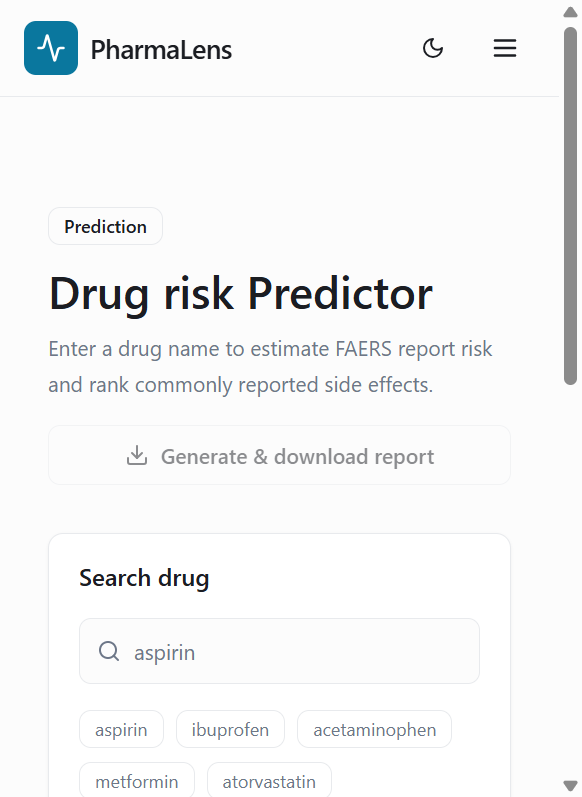
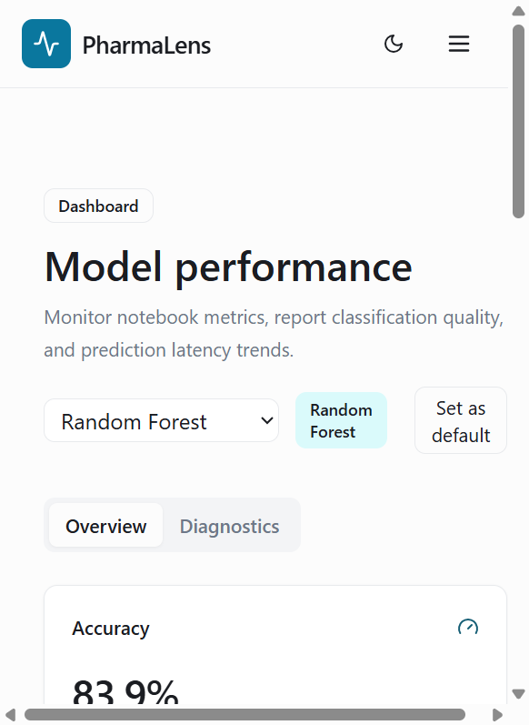

# PHARMALENS: FAERS DRUG-SAFETY ANALYSIS AND MODEL-ASSISTED REPORTING

**B.Voc Data Science Main Project**  
**Batch 2023 - 2026**  
## 7.6 Notebook Training and Artifact-Save Code

The notebook is the primary ML source of truth. It defines the three estimators, trains them using the shared transformed feature matrix, selects the best model using the stored evaluation rule, and saves the three named artifacts plus the fitted preprocessor. The following excerpt is from the notebook's training and save workflow.
**Documentation status:** Submission draft prepared from the current workspace implementation  
**Evidence date:** 2026-09-14

---

# ABSTRACT

PharmaLens is a web-based drug-safety analysis application that combines public adverse-event data, notebook-trained machine-learning classifiers, a FastAPI service, and a Next.js interface. A user enters a medicine name, selects Logistic Regression, Random Forest, or Gradient Boosting, and requests a prediction. The backend retrieves up to 200 matching reports from the openFDA Drug Event API, removes duplicate report identifiers, cleans the report fields, computes the observed percentage of reports marked serious, ranks reported reactions, and optionally applies the selected serialized classifier to report-level features. Results are presented with a risk category, confidence interval, report count, side effects, and model summary. The application can also create a human-readable report through Groq or Gemini, with a local fallback when provider credentials are unavailable, and returns a PDF download.

The notebook training workflow collected 8,000 raw reports in the latest recorded execution, retained 5,681 cleaned labeled records, and used an 80/20 stratified split. The stored application metrics report Random Forest and Gradient Boosting as tied on the combined F1 and ROC-AUC selection score of 0.903. The latest notebook execution observed in the workspace selected Gradient Boosting with a combined score of 0.903. This difference is documented rather than hidden because live openFDA data can change between runs. Final QA verified that all three joblib model artifacts load, all three model selections reach real inference, the backend tests pass, the frontend builds, and report PDFs can be generated and parsed.

**Keywords:** FAERS, openFDA, medication safety, adverse-event reports, machine learning, Logistic Regression, Random Forest, Gradient Boosting, FastAPI, Next.js, LLM report generation.

# 1. INTRODUCTION

## 1.1 Background

Medicine-safety analysis depends on evidence collected after medicines are used in real settings. Spontaneous adverse-event systems contain reports submitted by healthcare professionals, consumers, and other reporters. These records are useful for signal exploration, but they are not controlled experiments and a report does not prove that a medicine caused an event. A practical software tool must therefore present reported patterns carefully and distinguish observed evidence from individual medical advice.

PharmaLens addresses this problem as an analysis workflow. It uses the openFDA Drug Event API as a live source of FAERS reports. The application calculates a drug-level statistic from the returned reports and uses notebook-trained models to provide an additional report-level seriousness summary. The result is intended for demonstration, academic analysis, and safety-signal exploration.

## 1.2 Problem Statement

Manual inspection of adverse-event records is slow and difficult to compare consistently. A user needs to search a drug name, interpret serious-report proportions, find frequently reported reactions, compare trained classifiers, and prepare a readable summary. Without an integrated interface, these tasks require separate scripts, notebooks, API calls, and document tools.

## 1.3 Objectives

The verified project objectives are to:

1. Retrieve matching adverse-event reports for a user-entered drug name.
2. Convert nested openFDA records into the feature shape used by the notebook.
3. Produce an observed serious-report percentage and Low, Medium, or High category.
4. Allow a user to select Logistic Regression, Random Forest, or Gradient Boosting.
5. Apply the shared serialized preprocessor and the selected model when artifacts are available.
6. Rank common reported reactions.
7. Expose results through a typed FastAPI and Next.js application.
8. Create a readable AI-assisted or fallback summary and downloadable PDF report.
9. Provide a dashboard for stored evaluation metrics and latency observations.

## 1.4 Scope and Limitations

PharmaLens analyzes voluntary adverse-event reports. It does not diagnose a patient, establish causality, estimate the probability that an individual will experience an event, or replace a qualified healthcare professional. Live results depend on openFDA availability and the current contents of the public database. LLM-generated text is a summary layer; the underlying numerical response remains the application prediction response.

# 2. RELATED WORKS AND TECHNICAL BACKGROUND

## 2.1 Medication-Safety Information Systems

Medication-safety systems commonly combine structured records, adverse-event terminology, search, filtering, and statistical summaries. Their value comes from making large evidence collections easier to inspect. PharmaLens follows this pattern by exposing a drug search, a compact result summary, ranked reaction terms, and a model-performance dashboard.

## 2.2 Adverse-Event Reporting and Signal Interpretation

The FDA Adverse Event Reporting System is a spontaneous reporting system. Its records can support pharmacovigilance activities, but reporting volume is influenced by awareness, publicity, access to care, and reporting practices. PharmaLens therefore labels its output as reported-data analysis and includes a disclaimer in responses and PDF reports.

## 2.3 Machine Learning for Tabular Safety Records

Classical supervised models are suitable for compact tabular features. Logistic Regression provides a linear baseline. Random Forest combines decision trees and can represent nonlinear relationships. Gradient Boosting builds an additive ensemble sequentially. PharmaLens uses all three because their outputs can be compared through common evaluation metrics while preserving a simple deployment interface.

## 2.4 Language Models for Technical Summaries

The report layer uses an external language model only to turn an already-created prediction object into a short human-readable explanation. Groq is attempted first and Gemini is the fallback provider. If credentials are absent or both providers fail, PharmaLens produces a local deterministic summary. API keys are read server-side from environment variables and are not included in frontend payloads.

# 3. OVERVIEW OF ALGORITHMS

transformed = pd.DataFrame(
    transformed,
    columns=PREPROCESSOR.get_feature_names_out(),
    index=raw_features.index,
)
The project contains exactly three notebook classifiers. They predict whether an individual FAERS report is marked serious. The drug-level risk category shown by the application is calculated separately from the observed serious-report percentage.

## 3.1 Logistic Regression

**Purpose:** Provide an interpretable linear classification baseline.

**Input processing:** Numeric fields are median-imputed and scaled by the fitted preprocessor. Categorical fields are one-hot encoded with unknown and infrequent-category handling.

**Prediction mechanism:** The classifier estimates class probabilities from a linear combination of transformed features. The backend aggregates the probability of the serious class across the reports returned for a selected drug.

**Configuration recorded in the notebook:** `max_iter=1000`, `class_weight="balanced"`, and `random_state=42`.

**Limitations:** A linear decision boundary may not represent every interaction among report fields. Probabilities are not presented as calibrated individual medical risk.

## 3.2 Random Forest

**Purpose:** Provide a tree-ensemble model for nonlinear tabular relationships.

**Input processing:** It uses the same shared fitted preprocessor as the other classifiers, preserving feature order between training and inference.

**Prediction mechanism:** Multiple decision trees produce class predictions and probabilities. PharmaLens aggregates the serious-class probabilities and predicted serious fraction for the selected drug's reports.

**Configuration recorded in the notebook:** `n_estimators=300`, `max_depth=10`, `class_weight="balanced"`, and `random_state=42`.

**Limitations:** The model is less directly interpretable than the linear baseline, and the notebook did not store feature-importance values for the dashboard.

## 3.3 Gradient Boosting

**Purpose:** Provide a sequential ensemble that can learn nonlinear patterns in transformed tabular data.

**Input processing:** It uses the shared preprocessor and the same eight raw feature columns.

**Prediction mechanism:** Small decision trees are fitted sequentially. The notebook uses balanced sample weights during training because this estimator does not expose the same class-weight parameter as the other two models.

**Configuration recorded in the notebook:** `n_estimators=200`, `max_depth=3`, and `random_state=42`.

**Limitations:** Sequential fitting can be slower than a parallel tree ensemble and performance depends on the chosen configuration.

## 3.4 Risk Classification Rule
@app.post("/predict", response_model=PredictResponse)
def predict_drug(request: PredictRequest) -> PredictResponse:
    model_name = request.model_name
    if model_name:
        resolve_model_key(model_name)
    result = predict(request.drug_name.strip(), model_name)
    return PredictResponse(
        drug_name=result["drug_name"],
        risk_level=result["risk_level"],
        confidence=result["confidence"],
        serious_report_percentage=result["serious_report_percentage"],
        report_count=result["report_count"],
        side_effects=result["side_effects"],
        model=result["model"],
        message=result["message"],
    )
- **Medium:** from 71.1 percent to below 83.6 percent.
- **High:** 83.6 percent or above.

This rule describes the returned report population. It is not a clinical risk threshold for a person.

# 4. DATASET DETAILS

## 4.1 Data Source

The live application requests records from:

`https://api.fda.gov/drug/event.json`

The notebook execution uses a list of medicine names and requests a maximum of 200 reports for each name. The inference service performs a live query for the specific user-entered drug and caps the response at 200 reports.

## 4.2 Notebook Execution Counts

The latest recorded notebook execution collected 8,000 raw reports. After parsing, duplicate removal, cleaning, and removal of reports without usable serious labels, it retained 5,681 labeled records. The stratified split contained 4,544 training records and 1,137 test records.

These counts describe the recorded execution and are not a permanently frozen database snapshot. A later openFDA query may return different data.

## 4.3 Feature Inventory

| Feature | Type | Description | Role |
|---|---|---|---|
| age | Numeric | Patient onset age when reported in years | Model input |
| weight | Numeric | Patient weight when reported | Model input |
| num_reactions | Numeric | Number of reaction entries in a report | Model input |
| num_drugs | Numeric | Number of drug entries in a report | Model input |
| sex | Categorical | Reported patient sex code | Model input |
| route | Categorical | Suspect drug administration route | Model input |
| qualification | Categorical | Primary reporter qualification | Model input |
| country | Categorical | Occurrence country | Model input |
| serious | Binary target | openFDA value 1 or 2 mapped to serious or not serious | Training target |
| reaction_terms | List/text-like | Reported MedDRA reaction terms | Side-effect summary |

## 4.4 Cleaning and Transformation

The parser flattens nested patient, drug, reaction, reporter, and country fields. Duplicate reports are removed by `safetyreportid`. Age is converted to numeric form, retained only when the openFDA unit indicates years, and set missing outside the range 0 to 110. Weight is converted to numeric form. Missing categorical values receive explicit placeholders such as `Unknown` or `0`.

The fitted scikit-learn preprocessor then performs median imputation and scaling for numeric fields and one-hot encoding with infrequent-category handling for categorical fields. The API does not retrain this object during a prediction request; it loads the serialized preprocessor once at import time.

## 4.5 Target and Balancing

The notebook maps serious value `"1"` to class 1 and serious value `"2"` to class 0. The train/test split is stratified with `test_size=0.2` and `random_state=42`. Logistic Regression and Random Forest use balanced class weights. Gradient Boosting receives balanced sample weights.

# 5. RESULTS AND DISCUSSION

## 5.1 Stored Application Metrics

The dashboard reads the stored `backend/metrics.json` file. Its held-out test-set values are:

| Model | Accuracy | Precision | Recall | F1 | ROC-AUC | Combined score |
|---|---:|---:|---:|---:|---:|---:|
| Logistic Regression | 0.816 | 0.963 | 0.794 | 0.870 | 0.918 | 0.894 |
| Random Forest | 0.839 | 0.964 | 0.823 | 0.888 | 0.918 | 0.903 |
| Gradient Boosting | 0.842 | 0.957 | 0.833 | 0.891 | 0.915 | 0.903 |

The stored selection is Random Forest. The selection rule is the highest value of `(F1 + ROC-AUC) / 2` on the held-out test set. Random Forest and Gradient Boosting are tied after rounding.

## 5.2 Notebook Rerun Observation

The latest notebook cells executed in the workspace produced a different Random Forest test result and selected Gradient Boosting as the best model with a displayed combined score of 0.903. The Gradient Boosting test values observed in that run were accuracy 0.842, precision 0.957, recall 0.833, F1 0.891, and ROC-AUC 0.915.

The discrepancy is expected to be treated as a reproducibility limitation because the notebook retrieves live openFDA data and the application stores a separate metrics snapshot. The report does not claim that the two snapshots are identical.

## 5.3 QA and Runtime Results

Final QA evidence for the current workspace:

| Check | Result |
|---|---|
| Backend unit/API suite | 13 passed |
| Live serialized-model integration test | 1 passed |
| Frontend production build | Passed compilation, lint, and type checking |
| Logistic Regression live selection | Passed |
| Random Forest live selection | Passed |
| Gradient Boosting live selection | Passed |
| PDF generation and parsing | Passed |
| Empty drug validation | HTTP 422 |
| Unknown model validation | HTTP 400 |
| Zero latency buckets | HTTP 422 after fix |

## 5.4 Interpretation

The stored results show that the three classifiers are meaningfully above the majority-class accuracy baseline of 0.776 on the recorded test snapshot, but metric values should be interpreted in the context of voluntary reporting data and the live-data reproducibility limitation. The application is strongest as an exploratory engineering demonstration: it connects data retrieval, preprocessing, model selection, visualization, and reporting in one workflow.

# 6. CONCLUSION

PharmaLens implements an end-to-end drug-safety analysis workflow around public FAERS reports. It combines an openFDA retrieval layer, notebook-compatible cleaning, three serialized classifiers, a FastAPI backend, a Next.js user interface, a dashboard, and PDF report generation. The user can switch among Logistic Regression, Random Forest, and Gradient Boosting, and the selected model is visible in the result.

The verified strengths are the clear separation of drug-level statistics and report-level model summaries, the shared preprocessing artifact, controlled API validation, model availability reporting, and a usable report export path. The main limitations are reliance on a live external data source, the absence of a frozen data snapshot, uncalibrated model probabilities, provider-key dependence for external LLM summaries, unauthenticated administrative endpoints, and the difference between stored dashboard metrics and a later live-data notebook rerun.

Future work should include a versioned training snapshot, a scripted reproducibility command, authenticated administrative endpoints, rate limiting, server-side rebinding of report requests to a fresh prediction, and formal calibration analysis. These improvements should preserve the current model definitions unless a new experiment is explicitly documented.

# 7. IMPLEMENTATION DETAILS

## 7.1 Repository Structure

| Area | Current implementation |
|---|---|
| `backend/main.py` | FastAPI application, API routes, LLM calls, PDF generation |
| `backend/schemas.py` | Pydantic request and response schemas |
| `backend/logging_db.py` | SQLite prediction-latency logging |
| `backend/metrics.json` | Stored evaluation metrics and model selection metadata |
| `ml/preprocessing.py` | openFDA parsing, cleaning, labels, risk rule, side effects |
| `ml/inference.py` | Artifact loading, model registry, selection, report-level summaries |
| `ml/model_artifacts/` | Serialized classifiers and fitted preprocessor |
| `frontend/app/predict/page.tsx` | Drug input, model selector, prediction and report UI |
| `frontend/app/dashboard/page.tsx` | Metrics, confusion matrix, latency chart |
| `frontend/lib/api.ts` | Typed browser API client |
| `tests/` | API, report, model-selection, and integration tests |

## 7.2 Request Workflow

1. The browser loads available model metadata from `GET /models`.
2. The user enters a drug name and chooses a model key.
3. `predictDrug` sends `POST /predict` with `drug_name` and optional `model_name`.
4. FastAPI validates the request through Pydantic.
5. The inference module queries openFDA and parses the nested reports.
6. The selected model key is resolved against a fixed registry; arbitrary paths are not accepted.
7. The preprocessor transforms the report features and the selected estimator produces probabilities and labels.
8. The response returns drug-level statistics, side effects, confidence interval, and model summary.
9. The user can generate a report. The backend synthesizes a summary, builds a PDF, and returns both the PDF and an encoded summary header for on-screen display.

## 7.3 API Surface

| Method | Route | Purpose |
|---|---|---|
| GET | `/health` | Service and model-load status |
| GET | `/models` | Fixed model registry and artifact availability |
| POST | `/predict` | Live FAERS lookup and selected-model summary |
| GET | `/metrics` | Stored notebook evaluation metrics |
| POST | `/metrics/select` | Persist dashboard model selection |
| GET | `/latency` | Recent logged latency buckets |
| POST | `/report` | Generate PDF and summary from a prediction response |
| POST | `/report/summary` | Return a summary response for report display |

## 7.4 Validation and Error Handling

Missing or empty drug names are rejected by request validation. Unknown model identifiers return HTTP 400. A configured model whose artifact is unavailable returns HTTP 503. Upstream request failures are returned as HTTP 502. The latency endpoint restricts bucket count to a valid range and returns HTTP 422 for zero. Report text is escaped before insertion into ReportLab markup and download filenames are sanitized.

## 7.5 LLM and Report Pipeline

The report prompt includes aggregate fields such as drug name, risk level, report count, side effects, and selected model summary. It does not forward arbitrary prediction keys. Groq is called through its OpenAI-compatible chat-completions endpoint using `GROQ_API_KEY`. Gemini is the fallback provider using `GEMINI_API_KEY`. Empty provider responses are rejected. When both calls fail, a local summary is produced so the PDF remains useful and does not become blank.

The PDF contains a title, drug and timestamp, risk level, humanized summary, prediction details, side-effect table, selected model metrics, and a disclaimer. It is returned with `application/pdf` and a sanitized attachment filename.

## 7.6 Three Separate Algorithm Implementations

The original project uses one notebook, not three separate notebooks. The following listings logically separate that notebook into three complete algorithm sections for documentation and viva presentation. Each listing begins with the cleaned notebook dataframe `df`, creates the same feature matrix and fitted preprocessor, trains only one algorithm, evaluates it, and saves that algorithm's artifact. The repeated preparation is intentional: it makes each algorithm understandable as an independent implementation without claiming that the project trained three unrelated pipelines.

### 7.6.1 Algorithm 1 - Logistic Regression

```python
from pathlib import Path
import joblib
import pandas as pd
from sklearn.compose import ColumnTransformer
from sklearn.impute import SimpleImputer
from sklearn.linear_model import LogisticRegression
from sklearn.metrics import accuracy_score, f1_score, precision_score, recall_score, roc_auc_score
from sklearn.model_selection import train_test_split
from sklearn.pipeline import Pipeline
from sklearn.preprocessing import OneHotEncoder, StandardScaler

RANDOM_STATE = 42
NUMERIC_COLUMNS = ["age", "weight", "num_reactions", "num_drugs"]
CATEGORICAL_COLUMNS = ["sex", "route", "qualification", "country"]

# df is the cleaned notebook dataframe with the binary serious target.
features = df[NUMERIC_COLUMNS + CATEGORICAL_COLUMNS].copy()
target = df["serious"].astype(int)
X_train_raw, X_test_raw, y_train, y_test = train_test_split(
    features, target, test_size=0.2, random_state=RANDOM_STATE, stratify=target
)

numeric_pipeline = Pipeline([
    ("imputer", SimpleImputer(strategy="median")),
    ("scaler", StandardScaler()),
])
categorical_encoder = OneHotEncoder(
    handle_unknown="infrequent_if_exist", max_categories=11, sparse_output=False
)
preprocessor = ColumnTransformer([
    ("num", numeric_pipeline, NUMERIC_COLUMNS),
    ("cat", categorical_encoder, CATEGORICAL_COLUMNS),
])

X_train = preprocessor.fit_transform(X_train_raw, y_train)
X_test = preprocessor.transform(X_test_raw)

logistic_regression = LogisticRegression(
    max_iter=1000, class_weight="balanced", random_state=RANDOM_STATE
)
logistic_regression.fit(X_train, y_train)

predictions = logistic_regression.predict(X_test)
probabilities = logistic_regression.predict_proba(X_test)[:, 1]
metrics = {
    "accuracy": accuracy_score(y_test, predictions),
    "precision": precision_score(y_test, predictions, zero_division=0),
    "recall": recall_score(y_test, predictions, zero_division=0),
    "f1": f1_score(y_test, predictions, zero_division=0),
    "roc_auc": roc_auc_score(y_test, probabilities),
}
print("Logistic Regression:", metrics)

artifact_dir = Path("ml/model_artifacts")
artifact_dir.mkdir(parents=True, exist_ok=True)
joblib.dump(logistic_regression, artifact_dir / "logistic_regression.joblib")
joblib.dump(preprocessor, artifact_dir / "preprocessor.joblib")
```

### 7.6.2 Algorithm 2 - Random Forest

```python
from pathlib import Path
import joblib
import pandas as pd
from sklearn.compose import ColumnTransformer
from sklearn.impute import SimpleImputer
from sklearn.ensemble import RandomForestClassifier
from sklearn.metrics import accuracy_score, f1_score, precision_score, recall_score, roc_auc_score
from sklearn.model_selection import train_test_split
from sklearn.pipeline import Pipeline
from sklearn.preprocessing import OneHotEncoder, StandardScaler

RANDOM_STATE = 42
NUMERIC_COLUMNS = ["age", "weight", "num_reactions", "num_drugs"]
CATEGORICAL_COLUMNS = ["sex", "route", "qualification", "country"]

features = df[NUMERIC_COLUMNS + CATEGORICAL_COLUMNS].copy()
target = df["serious"].astype(int)
X_train_raw, X_test_raw, y_train, y_test = train_test_split(
    features, target, test_size=0.2, random_state=RANDOM_STATE, stratify=target
)

numeric_pipeline = Pipeline([
    ("imputer", SimpleImputer(strategy="median")),
    ("scaler", StandardScaler()),
])
categorical_encoder = OneHotEncoder(
    handle_unknown="infrequent_if_exist", max_categories=11, sparse_output=False
)
preprocessor = ColumnTransformer([
    ("num", numeric_pipeline, NUMERIC_COLUMNS),
    ("cat", categorical_encoder, CATEGORICAL_COLUMNS),
])

X_train = preprocessor.fit_transform(X_train_raw, y_train)
X_test = preprocessor.transform(X_test_raw)

random_forest = RandomForestClassifier(
    n_estimators=300, max_depth=10,
    class_weight="balanced", random_state=RANDOM_STATE
)
random_forest.fit(X_train, y_train)

predictions = random_forest.predict(X_test)
probabilities = random_forest.predict_proba(X_test)[:, 1]
metrics = {
    "accuracy": accuracy_score(y_test, predictions),
    "precision": precision_score(y_test, predictions, zero_division=0),
    "recall": recall_score(y_test, predictions, zero_division=0),
    "f1": f1_score(y_test, predictions, zero_division=0),
    "roc_auc": roc_auc_score(y_test, probabilities),
}
print("Random Forest:", metrics)

artifact_dir = Path("ml/model_artifacts")
artifact_dir.mkdir(parents=True, exist_ok=True)
joblib.dump(random_forest, artifact_dir / "random_forest.joblib")
joblib.dump(preprocessor, artifact_dir / "preprocessor.joblib")
```

### 7.6.3 Algorithm 3 - Gradient Boosting

```python
from pathlib import Path
import joblib
import pandas as pd
from sklearn.compose import ColumnTransformer
from sklearn.ensemble import GradientBoostingClassifier
from sklearn.impute import SimpleImputer
from sklearn.metrics import accuracy_score, f1_score, precision_score, recall_score, roc_auc_score
from sklearn.model_selection import train_test_split
from sklearn.pipeline import Pipeline
from sklearn.preprocessing import OneHotEncoder, StandardScaler
from sklearn.utils.class_weight import compute_sample_weight

RANDOM_STATE = 42
NUMERIC_COLUMNS = ["age", "weight", "num_reactions", "num_drugs"]
CATEGORICAL_COLUMNS = ["sex", "route", "qualification", "country"]

features = df[NUMERIC_COLUMNS + CATEGORICAL_COLUMNS].copy()
target = df["serious"].astype(int)
X_train_raw, X_test_raw, y_train, y_test = train_test_split(
    features, target, test_size=0.2, random_state=RANDOM_STATE, stratify=target
)

numeric_pipeline = Pipeline([
    ("imputer", SimpleImputer(strategy="median")),
    ("scaler", StandardScaler()),
])
categorical_encoder = OneHotEncoder(
    handle_unknown="infrequent_if_exist", max_categories=11, sparse_output=False
)
preprocessor = ColumnTransformer([
    ("num", numeric_pipeline, NUMERIC_COLUMNS),
    ("cat", categorical_encoder, CATEGORICAL_COLUMNS),
])

X_train = preprocessor.fit_transform(X_train_raw, y_train)
X_test = preprocessor.transform(X_test_raw)
sample_weight = compute_sample_weight("balanced", y_train)

gradient_boosting = GradientBoostingClassifier(
    n_estimators=200, max_depth=3, random_state=RANDOM_STATE
)
gradient_boosting.fit(X_train, y_train, sample_weight=sample_weight)

predictions = gradient_boosting.predict(X_test)
probabilities = gradient_boosting.predict_proba(X_test)[:, 1]
metrics = {
    "accuracy": accuracy_score(y_test, predictions),
    "precision": precision_score(y_test, predictions, zero_division=0),
    "recall": recall_score(y_test, predictions, zero_division=0),
    "f1": f1_score(y_test, predictions, zero_division=0),
    "roc_auc": roc_auc_score(y_test, probabilities),
}
print("Gradient Boosting:", metrics)

artifact_dir = Path("ml/model_artifacts")
artifact_dir.mkdir(parents=True, exist_ok=True)
joblib.dump(gradient_boosting, artifact_dir / "gradient_boosting.joblib")
joblib.dump(preprocessor, artifact_dir / "preprocessor.joblib")
```

The notebook's actual final save cell also writes `best_model.joblib` as the selected compatibility copy. The API does not retrain these models; it loads the named artifacts and lets the user switch between them through the fixed registry.

## 7.7 Backend Model Registry and Inference Code

The backend uses a fixed registry. A browser request can select a key, alias, or friendly model name, but it cannot provide an arbitrary serialized-file path.

```python
selected_key = resolve_model_key(model_name, require_available=bool(model_name))
if selected_key is not None:
    selected_model_name, model_obj = MODELS[selected_key]
    selected_summary = _model_report_summary_for(model_obj, frame_with_labels)
```

After notebook-compatible cleaning, the serialized preprocessor transforms the raw fields and the selected estimator produces the report-level result:

```python
raw_features = clean_report_features(frame)
transformed = PREPROCESSOR.transform(raw_features)
transformed = pd.DataFrame(
    transformed,
    columns=PREPROCESSOR.get_feature_names_out(),
    index=raw_features.index,
)
probabilities = model.predict_proba(transformed)
predicted_labels = model.predict(transformed)
```

## 7.8 Frontend Model Selection and Report Download Code

The frontend keeps the selected model key in component state and includes it in the JSON request:

```typescript
export function predictDrug(drugName: string, modelName?: string | null) {
  const body: Record<string, unknown> = { drug_name: drugName };
  if (modelName) body.model_name = modelName;
  return request<PredictResponse>("/predict", {
    method: "POST",
    body: JSON.stringify(body),
  });
}
```

The report action reuses the same generated response for both on-screen display and download:

```typescript
const report = await generateReport(result);
setReportSummary(report.summary || "Report generated successfully.");
const url = URL.createObjectURL(report.blob);
const link = document.createElement("a");
link.href = url;
link.download = `pharmalens_report_${result.drug_name.replace(/\s+/g, "_")}.pdf`;
document.body.appendChild(link);
link.click();
link.remove();
URL.revokeObjectURL(url);
```

## 7.9 Backend Integration Code

This route is the integration boundary between browser input, request validation, fixed model selection, live FAERS lookup, and the typed response schema:

```python
@app.post("/predict", response_model=PredictResponse)
def predict_drug(request: PredictRequest) -> PredictResponse:
    model_name = request.model_name
    if model_name:
        resolve_model_key(model_name)
    result = predict(request.drug_name.strip(), model_name)
    return PredictResponse(
        drug_name=result["drug_name"],
        risk_level=result["risk_level"],
        confidence=result["confidence"],
        serious_report_percentage=result["serious_report_percentage"],
        report_count=result["report_count"],
        side_effects=result["side_effects"],
        model=result["model"],
        message=result["message"],
    )
```

# 8. OUTPUT

## 8.1 Predict Page

The Predict page provides a drug-name field, autocomplete suggestions, a model selector, a prediction button, result cards, selected-model metrics, ranked side effects, and report generation. The current UI displays all three available models when the artifacts are present.



## 8.2 Dashboard

The Dashboard displays the selected model's stored accuracy, F1, ROC-AUC, confusion matrix, recent latency, and diagnostics tab. It reads metrics from the backend rather than recalculating them in the browser.



## 8.3 Example Output

For a live aspirin lookup during QA, the application returned 200 reports, a 52.5 percent serious-report percentage, a Low category, and ranked reactions including Dizziness, Fatigue, Haemoglobin decreased, Diarrhoea, and Rash. The selected model output was returned separately; this prevents the report-level classifier summary from being confused with the drug-level observed percentage.

## 8.4 PDF Output

A generated report is a PDF attachment named using the sanitized drug name. Programmatic QA opened the returned bytes with `pypdf`, confirmed a non-empty PDF, verified the `application/pdf` MIME type, and extracted the PharmaLens report heading and generated summary.

# 9. TESTING AND QUALITY ASSURANCE

The final validation combined source inspection, notebook evidence, unit tests, live model integration, API probes, frontend builds, browser interaction, PDF parsing, malformed-content checks, invalid-input checks, and a source-level security scan. The final backend suite passed 13 tests. The serialized-model integration test passed for all three models. The frontend production build passed compilation, linting, and type checking.

The live openFDA dependency can still fail transiently. In that case the API returns a controlled 502 rather than silently fabricating a prediction. A production deployment should add a versioned offline fixture or retry policy if uninterrupted demonstrations are required.

# 10. REFERENCES

[1] U.S. Food and Drug Administration, "FDA Adverse Event Reporting System (FAERS) Public Dashboard," official pharmacovigilance resource. https://www.fda.gov/drugs/questions-and-answers-fdas-adverse-event-reporting-system-faers/fda-adverse-event-reporting-system-faers-public-dashboard

[2] U.S. Food and Drug Administration, "openFDA API," official API documentation. https://open.fda.gov/apis/

[3] U.S. Food and Drug Administration, "Drug Event API," openFDA endpoint documentation. https://open.fda.gov/apis/drug/event/

[4] F. Pedregosa et al., "Scikit-learn: Machine Learning in Python," Journal of Machine Learning Research, vol. 12, pp. 2825-2830, 2011. https://jmlr.org/papers/v12/pedregosa11a.html

[5] Scikit-learn developers, "User Guide," official documentation. https://scikit-learn.org/stable/user_guide.html

[6] FastAPI contributors, "FastAPI Documentation," official framework documentation. https://fastapi.tiangolo.com/

[7] Vercel, "Next.js Documentation," official framework documentation. https://nextjs.org/docs

[8] ReportLab, "ReportLab Documentation," official PDF-generation documentation. https://docs.reportlab.com/

[9] Groq, "Groq API Documentation," official provider documentation. https://console.groq.com/docs

[10] Google, "Gemini API Documentation," official provider documentation. https://ai.google.dev/gemini-api/docs

[11] PharmaLens source notebook, `drug_risk_classifier_api.ipynb`, current workspace evidence.

[12] PharmaLens source modules, tests, metrics, and serialized artifacts, current workspace evidence.
